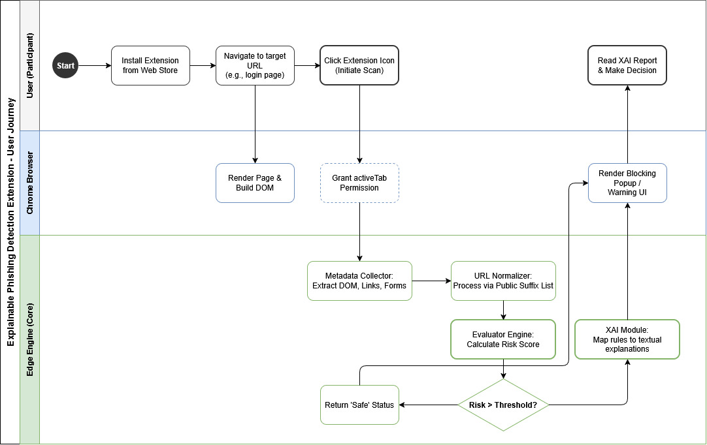

# Hybrid Edge AI for Explainable Phishing Detection

## 1. Project Overview
**Problem:** Modern browser warnings act as "black boxes." Generic risk labels cause alert fatigue, leaving users unsure why a page is blocked, which increases false suspicion and unsafe bypassing.
**Target Users:** Adult undergraduate students using desktop Chrome.
**Expected Outcomes:** 
1. An auditable, locally running browser extension prototype.
2. A measured estimate of how deterministic explanations affect human webpage classification decisions (Participant Balanced Accuracy).

## 2. Team and Organization
-   **Team Members:** Inayatulla Noyan & Nurtilek Koblandy
-   **Roles:** 
    *   *Inayatulla:* Literature review, user needs, UI/UX, dataset curation, and model training.
    *   *Nurtilek:* Requirements, architecture, metadata collector, rules engine, and LLM integration.
-   **Supervisor:** Altynbek Seitenov
-   **Project Tracker (YouTrack):** [PHISH Board](https://inayatulla.youtrack.cloud/projects/PHISH)

## 3. Project Scope and Architecture
This project utilizes a **Hybrid Edge AI** architecture ensuring **Zero-Data Leakage**.

-   **In Scope:** Desktop Chrome execution (MV3), bounded on-demand active-tab scanning, offline-trained Random Forest classifier, and local WebLLM/WebGPU explanation generation.
-   **Out of Scope:** Continuous background monitoring, remote inference backends, third-party phishing APIs, and automatic credential interception.

## 4. Technology Choices
-   **Offline Research & Model Build:** Python, scikit-learn (Random Forest), pandas.
-   **Browser Runtime:** TypeScript / JavaScript, Chrome Manifest V3 API.
-   **Local XAI Engine:** Tree JSON Inference, WebLLM / WebGPU (for explanation verbalization).

## 5. Current Status & Documentation
**Status:** Pre-Defense 1 Stage (Architecture, Requirements, and Evaluation Plan Frozen).

**Primary Documentation:**
-   [Master Pre-Defense Report (PDF)](docs/Hybrid_Edge_AI_Predefense_Report.pdf)
-   [Architecture Diagrams](docs/architecture/)
-   [User Interview Records](docs/user_interviews.md)
-   [Archive of Superseded Rules-Only Documents](docs/archive/)

---
*Note: This repository contains the source code and documentation for the Hybrid Edge AI proposal. Large artifacts (datasets, trained model weights) are managed externally during the research phase.*